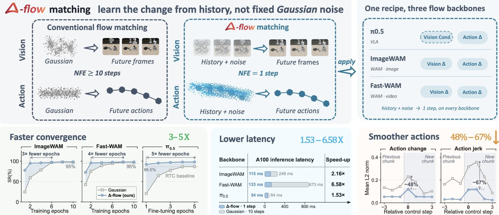
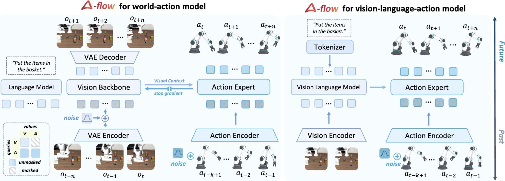

<p align="center">
  
</p>

<h1 align="center">Δ Flow Matching for Robot Foundation Models</h1>

<p align="center">
  
  
  
</p>

<p align="center">
  Kuangji Zuo<sup>*</sup>,
  <a href="https://morpheus-an.github.io/">Tuo An</a><sup>*</sup>,
  Xinying Guo,
  <a href="https://reagan1311.github.io/">Gen Li</a>,
  Mengfei Zhao,
  Jiaqi Bai,
  Bofan Lyu,
  Zhuoyuan Yu,
  Jinghan Yang,
  Jiayi Li,
  <a href="https://jiajindou.github.io/">Jindou Jia</a><sup>†‡</sup>,
  <a href="https://marsyang.site/">Jianfei Yang</a><sup>†</sup>
  <br>
  MARS Lab, Nanyang Technological University
  <br>
  <sub><sup>*</sup>Equal contribution &nbsp;&nbsp; <sup>‡</sup>Project lead &nbsp;&nbsp; <sup>†</sup>Corresponding authors</sub>
</p>

> [!NOTE]
> The code is not released yet. The code, along with links to the paper and project page, will be added here once they are public. Star or watch this repository to get notified.

<p align="center">
  
</p>

Robot foundation models built on flow matching start every generation from fixed Gaussian noise, even though the robot already knows its recent past. **Δ-flow** starts the flow from that history instead: each source is the recent visual state or action plus mild noise, so the network only learns the small change Δ from past to future. Only the source changes. There are no new modules and no extra data.

## Highlights

- **Faster training.** Converges 3–5× faster than the Gaussian-source versions of ImageWAM, Fast-WAM and π<sub>0.5</sub>.
- **One-step inference.** A single flow step cuts latency by 1.53–6.58×.
- **Smooth actions.** 4.5× lower action jerk than one-step Gaussian sampling.
- **Stronger generalization.** State-of-the-art results on LIBERO-Plus.
- **Works without retraining.** Replacing the Gaussian source of an already-trained policy with its history keeps its performance at a single step.

## Method

<p align="center">
  
</p>

In world-action models (ImageWAM, Fast-WAM), Δ-flow replaces the source of both the visual and the action branch. In vision-language-action models (π<sub>0.5</sub>), it replaces the source of the action branch. Inference uses one Euler step.

## Release plan

- [ ] Paper on arXiv
- [ ] Project page
- [ ] Training and evaluation code

## Citation

If you find this work useful, please cite:

```bibtex
@article{zuo2026deltaflow,
  title   = {$\Delta$ Flow Matching for Robot Foundation Models},
  author  = {Zuo, Kuangji and An, Tuo and Guo, Xinying and Li, Gen and
             Zhao, Mengfei and Bai, Jiaqi and Lyu, Bofan and Yu, Zhuoyuan and
             Yang, Jinghan and Li, Jiayi and Jia, Jindou and Yang, Jianfei},
  journal = {arXiv preprint},
  year    = {2026}
}
```
